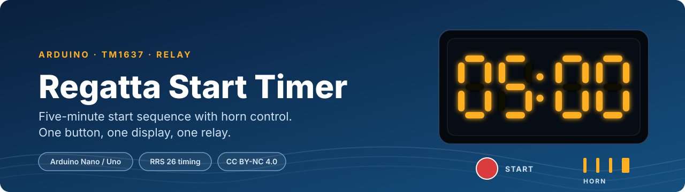
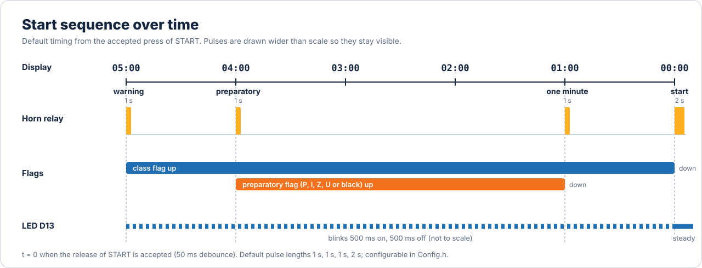
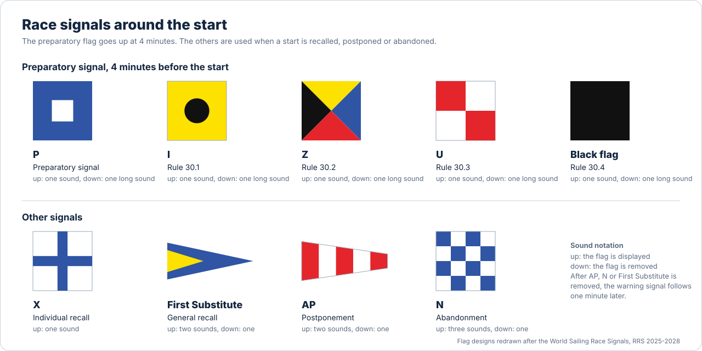
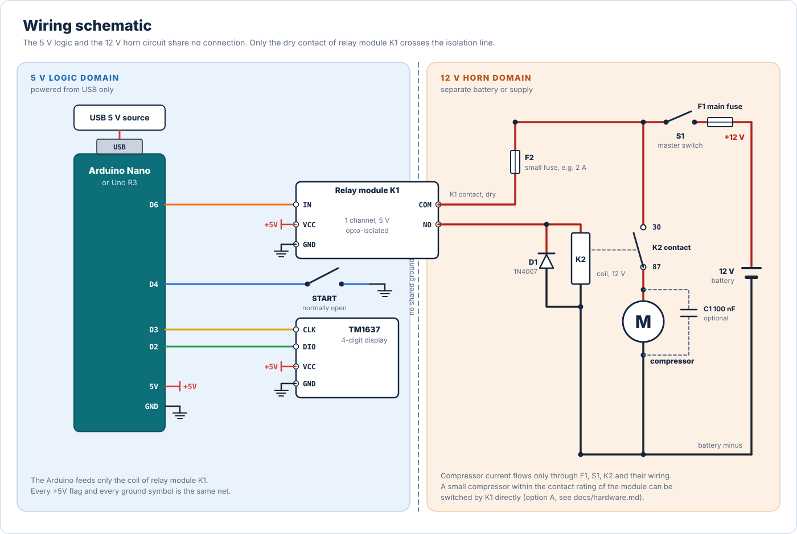
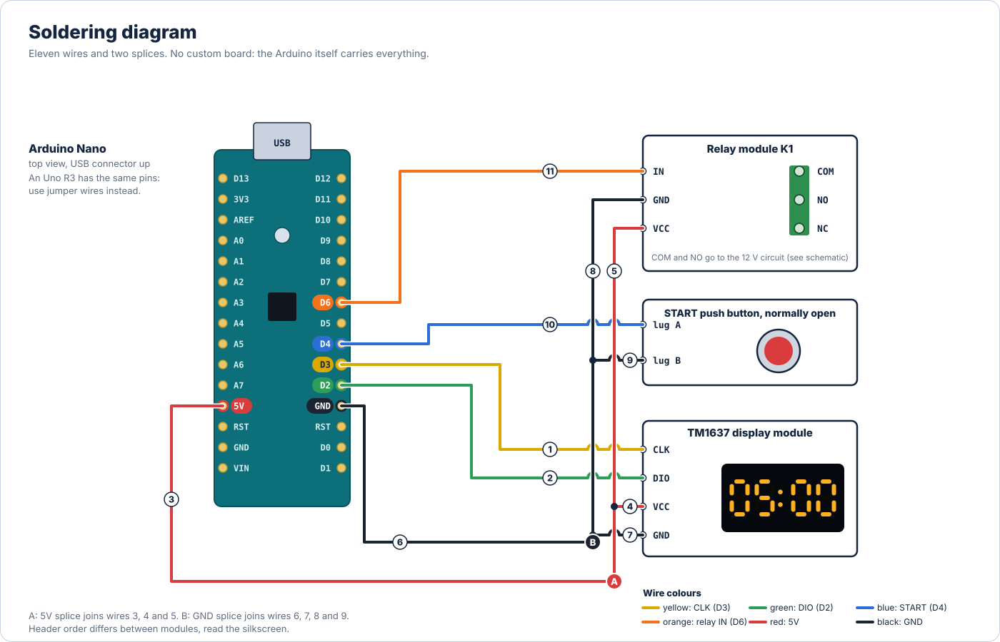

<p align="center">
  
</p>

<p align="center">
  <a href="LICENSE"></a>
  
  
  <a href="https://github.com/diggahpl/Regatta-start-timer/actions/workflows/ci.yml"></a>
  <a href="README.pl.md"></a>
</p>

<h3 align="center">A five-minute start sequence for race committees.<br>One button, one display, one relay for the horn.</h3>

<p align="center">
  <a href="#start-procedure-in-racing">Start procedure</a> ·
  <a href="#hardware">Hardware</a> ·
  <a href="#build-and-flash">Build</a> ·
  <a href="docs/firmware.md">Firmware</a> ·
  <a href="docs/testing.md">Tests</a> ·
  <a href="docs/design-review.md">Design review</a>
</p>

---

## What it is

Regatta Start Timer counts down the standard five-minute start sequence and sounds the horn at 05:00, 04:00, 01:00 and 00:00. A short press of START begins the sequence. Holding the same button for three seconds aborts it. The countdown runs on a TM1637 four-digit display, and the horn is switched by a relay, so the timer can drive anything from a small electric horn to a compressor air horn running from its own supply.

It is built for race committees, coaches and club volunteers who run starts from a boat or a shore station and want the sound signals made by a clock instead of by hand.

Original project, designed and built by diggahpl. The first version dates from 2025 and has been used at regattas. This repository is the cleaned-up, documented and tested edition.

## At a glance

| One button | Five-minute countdown | Four horn signals |
| --- | --- | --- |
| A short click starts the sequence. Holding it for 3 seconds aborts it. | 05:00 down to 00:00 on a TM1637 display with a steady colon. | A relay output fires at 05:00, 04:00, 01:00 and 00:00 and switches the horn from its own supply. |

| Configurable | Tested | No custom PCB |
| --- | --- | --- |
| Signal lengths, relay trigger level, clock trim and brightness live in one `Config.h`. | 110 automated scenarios, a mutation check and an equivalence check against the 2025 sketch. | An Arduino Nano or Uno, a few modules and 11 soldered wires with two splices. |

## The start sequence

<p align="center">
  
</p>

Time zero is the moment the release of START is accepted, 50 ms after the button opens. The first horn pulse sounds at that instant, and every later event is timed from the same moment.

| Display | Time from start | Horn relay | Race committee, standard sequence |
| --- | ---: | --- | --- |
| 05:00 | 0 s | 1 s | Warning signal: class flag up |
| 04:00 | 60 s | 1 s | Preparatory signal: P, I, Z, Z with I, U or black flag up |
| 01:00 | 240 s | 1 s (default) | One-minute signal: preparatory flag down |
| 00:00 | 300 s | 2 s | Starting signal: class flag down |

The display shows 00:00 for the whole starting pulse, then returns to 05:00 and waits for the next press. The pulse lengths are the defaults from the 2025 sketches and can be changed in `Config.h`.

## Start procedure in racing

Apart from the length of the one-minute sound (see the end of this section), the sequence above follows rule 26 of the [Racing Rules of Sailing 2025-2028](https://media.sailing.org/sailing/wp-content/uploads/2025/07/29083752/2025-2028-RRS-with-Changes-and-Corrections.pdf). Times are taken from the visual signals, and a missing sound signal is disregarded. The notice of race or the sailing instructions may change the five-minute warning time. The warning signal for each following class is made with or after the starting signal of the class before it.

<p align="center">
  
</p>

### Preparatory flags

The preparatory flag goes up at 04:00 with one sound and comes down at 01:00 with one long sound. The flag chosen decides what happens to a boat that is too early.

| Flag | Rule | In the last minute before the starting signal |
| --- | --- | --- |
| P | none | Marks the preparatory signal. No start penalty. |
| I | 30.1 | A boat with any part of her hull on the course side of the line or its extensions must sail across an extension so that her hull is completely on the pre-start side, then start. |
| Z | 30.2 | No part of the hull may be in the triangle formed by the ends of the line and the first mark. A boat that breaks this and is identified gets a 20% scoring penalty without a hearing, even if the race is restarted or resailed. Identified again in a later attempt, she gets another 20%. |
| U | 30.3 | Same triangle. A boat that breaks it and is identified is disqualified without a hearing, but not if the race is restarted or resailed. |
| Black | 30.4 | Same triangle. Disqualified without a hearing even if the race is restarted or resailed. After a general recall or an abandonment after the start, the sail number is displayed before the next warning signal and the boat may not sail the restarted race. |

Z with I means both the I flag rule and the Z flag rule are in effect. A penalty from Z or black does not apply if the race is postponed or abandoned before the starting signal.

### Recalls, postponement and abandonment

| Situation | Flag | Sound | What it means | With the timer |
| --- | --- | --- | --- | --- |
| Individual recall | X | one when raised | At the starting signal a boat is on the course side or must comply with 30.1. The flag stays up until those boats have returned, but no later than 4 minutes after the start or 1 minute before a later start, whichever is earlier. | Not generated. Use a manual horn. |
| General recall | First Substitute | two when raised, one when lowered | The committee cannot identify the boats, or the start procedure had an error. The new warning signal is made one minute after the flag comes down. | If the sequence is still running, hold START for 3 s to abort it. Release START exactly one minute after the flag is lowered. |
| Postponement | AP | two when raised, one when lowered | Races not started are postponed (rule 27.3). The warning signal follows one minute after the flag comes down, unless the race is postponed or abandoned again. | Same as a general recall. |
| Postponement with a second flag | AP over H, AP over A | two when raised | Races not started are postponed. Over H: further signals ashore. Over A: no more racing today. | Abort a running sequence by holding START. |
| Abandonment | N | three when raised, one when lowered | Races in progress are abandoned, before the start under rule 27.3 and after it under rule 32.1. The warning signal follows one minute after the flag comes down, unless the race is abandoned again or postponed. | Same as a general recall. |
| Abandonment with a second flag | N over H, N over A | three when raised | Races in progress are abandoned. Over H: further signals ashore. Over A: no more racing today. | Abort a running sequence by holding START. |

### Using the timer for restarts and following classes

- The first horn pulse of a new sequence is the warning signal. Release START at the moment that signal is due: the horn sounds when the release is accepted, about 50 ms later.
- Hold START for 3 seconds to cancel a running sequence. The relay is released at once.
- Clicks are ignored while a cycle runs, which includes the 2 s starting pulse. To start the next class, press START right after the starting pulse has ended. Its warning signal then comes at least 2 seconds after the previous starting signal, which the rule allows because it says "with or after".
- Rule 26 asks for one long sound at one minute, and the default 1 s pulse is not that. For a long sound set `SOUND_AT_ONE_MS` (for example to 3000) and check the result with the real horn.

### Example: Optimist class

The starting procedure is set by rule 26 together with the notice of race and the sailing instructions of each event, and those can differ from one Optimist event to the next. Two sources show how much room the sailing instructions leave:

- The sailing instructions of a [2024 Optimist event at California Yacht Club](https://resultsarchive.calyachtclub.com/files/2024/2024OptiWCCSI_Final.pdf) name the Optimist class flag as the class flag. Orange starting-line flags go up with one sound at least four minutes before a warning signal, so boats know a race or a sequence of races is about to begin. A boat that does not start within five minutes after her starting signal is scored DNS. The timer does not produce that four-minute attention signal. The committee makes it by hand, and the timer starts at the warning signal. The same document has an addendum for its novice Green Fleet that starts races with sounds under Appendix U, a three-minute sequence, which this five-minute timer does not fit.
- In 2014 the regatta committee of the International Optimist Dinghy Association [announced trials of the U flag](https://www.sailingscuttlebutt.com/2014/03/27/optimist-class-test-new-starting-system/). The stated aim was a system that avoids general recalls without a long start procedure and without a penalty as strong as the black flag. Rule 30.3 says a U flag penalty does not stand if the race is restarted or resailed.

Read the notice of race and the sailing instructions of your event. The warning time, the class flag and the preparatory flag may differ from the standard sequence.

### What the timer covers

| Covered by the timer | Left to the race committee |
| --- | --- |
| Countdown display from 05:00 to 00:00 | Raising and lowering every flag |
| Horn pulses at 05:00, 04:00, 01:00 and 00:00 | Individual recall (one sound) and general recall (two sounds) |
| Abort by holding START | Postponement, abandonment and restarting one minute after the flag is lowered |
| | Course, starting line, scoring and penalties |

The timer is a timing aid. Keep an independent stopwatch, the flags and a manual sound signal at hand. The race committee stays responsible for the start.

## Hardware

<p align="center">
  
</p>

The 5 V logic domain (Arduino, display, button, relay module K1) and the 12 V horn domain (battery, fuse, switch, compressor) share no ground. Only the dry contact of the relay module crosses between them. The compressor current flows through the fuse, the master switch, a 12 V automotive relay K2 and the wiring in the 12 V domain, never through the Arduino or the module.

Two relay stages are possible. Option B is the recommended one: K1 switches only the coil of K2, and K2 switches the compressor. Option A lets K1 switch the compressor directly and fits only when the module's contact rating, for direct current, an inductive load and the start-up surge, covers the compressor. Typical module contacts are rated at around 10 A for resistive loads, so most compressors need option B.

<p align="center">
  
</p>

| Part | Notes |
| --- | --- |
| Arduino Nano (ATmega328P) or Uno R3 | A Nano with a quartz crystal keeps better time than the Uno's ceramic resonator |
| TM1637 four-digit display module | 5 V, with a colon between the digits |
| Momentary push button, normally open | START, one contact to GND |
| 5 V relay module K1 | One channel, dry contact, ideally opto-isolated with a selectable trigger level |
| 12 V automotive relay K2 with socket | 30 to 40 A class, for option B |
| Fuse F1 and master switch S1 | F1 close to the battery plus, sized for the compressor and its wiring, S1 rated for the load |
| Fuse F2, diode D1 (1N4007) | F2 protects the K2 coil feed, D1 sits across the K2 coil with its cathode to +12 V |
| Wire, splices, heat-shrink, enclosure | Power wire sized for the current and the length |

The full parts list is in [`hardware/BOM.csv`](hardware/BOM.csv). Wire table, soldering order, first power-up checklist and compressor cautions are in [`docs/hardware.md`](docs/hardware.md).

A compressor draws several times its running current when it starts, and its sound lags the relay pulse by the spin-up time. Take the current and the fuse rating from the compressor's data sheet, and tune the pulse lengths by ear.

## Build and flash

Arduino IDE:

1. Install **Arduino AVR Boards** in the Boards Manager.
2. In the Library Manager install **TM1637** by Avishay Orpaz, version 1.2.0.
3. Open `firmware/RegattaStartTimer/RegattaStartTimer.ino`.
4. Pick **Arduino Uno**, or **Arduino Nano** with the processor `ATmega328P` or `ATmega328P (Old Bootloader)`, then choose the port.
5. Verify and upload with the 12 V domain switched off. The display shows 05:00.

Arduino CLI:

```sh
arduino-cli core install arduino:avr@1.8.8
arduino-cli lib install "TM1637@1.2.0"

arduino-cli compile --fqbn arduino:avr:uno firmware/RegattaStartTimer
arduino-cli compile --fqbn arduino:avr:nano:cpu=atmega328 firmware/RegattaStartTimer
arduino-cli compile --fqbn arduino:avr:nano:cpu=atmega328old firmware/RegattaStartTimer

arduino-cli upload -p <port> --fqbn arduino:avr:uno firmware/RegattaStartTimer
```

Any macro option can also be set at build time, for example a relay module that triggers on LOW:

```sh
arduino-cli compile --fqbn arduino:avr:uno \
  --build-property "build.extra_flags=-DHORN_ACTIVE_HIGH=0" firmware/RegattaStartTimer
```

The sketch takes 2710 bytes of flash (8%) and 90 bytes of RAM (4%) on the Uno and on both Nano variants, and compiles without warnings. More in [`docs/firmware.md`](docs/firmware.md).

## Operating it

| Action | Result |
| --- | --- |
| Power on or reset | Display shows 05:00, the horn relay is released, the built-in LED is on. A button held at power-up is ignored. |
| Short click on START | The cycle begins when the release is accepted. The first horn pulse sounds at once and the LED blinks. |
| Click during a cycle | Ignored. |
| Hold START for 3 s | The cycle aborts, the relay is released at once and the display returns to 05:00. Release the button and wait one second before the next press. |
| Press less than 1 s after the last release | Ignored. |
| Countdown reaches 00:00 | The starting pulse sounds for 2 s while the display shows 00:00, then the timer returns to 05:00. |

## Configuration

Everything a builder may change is in [`firmware/RegattaStartTimer/Config.h`](firmware/RegattaStartTimer/Config.h).

| Setting | Default | Meaning |
| --- | --- | --- |
| `HORN_ACTIVE_HIGH` | 1 | Relay module trigger level. Many cheap modules pull in on LOW, set 0 for those. |
| `SOUND_AT_FIVE_MS` | 1000 | Horn pulse at 05:00 |
| `SOUND_AT_FOUR_MS` | 1000 | Horn pulse at 04:00 |
| `SOUND_AT_ONE_MS` | 1000 | Horn pulse at 01:00 |
| `SOUND_AT_START_MS` | 2000 | Horn pulse at 00:00 |
| `CLOCK_TRIM_PPM` | 0 | Clock correction, from -10000 to 10000. Positive when the timer runs late. |
| `DISPLAY_BRIGHTNESS` | 5 | 0 to 7 |
| `SHOW_COLON` | 1 | 1 for a steady MM:SS, 0 for MMSS without the separator |

Each pulse must last between 1 and 5000 ms, and the compiler rejects values outside that range. The pin map, the 1 s display refresh and the debounce and hold times are constants in the same file.

## Quality and tests

| Check | Result |
| --- | --- |
| Native behaviour tests, 6 build variants | 110 scenarios pass |
| Mutation check | All 13 deliberately broken sketches are detected |
| Equivalence with the 2025 sketch | Pin and display traces are identical in all 18 default scenarios |
| Compilation | Uno and both Nano variants, no warnings |

```sh
make -C test test          # 110 scenarios
make -C test mutation      # 13 broken sketches must all fail the tests
make -C test equivalence   # same traces as the 2025 sketch
```

The native tests run the sketch against mocks of the Arduino core and the display, in 1 ms steps. They watch only the outputs, so the same scenarios run against the 2025 original. The 2025 button and timing logic passed every behavioural check, so the new sketch changes the hardware interface and the display refresh, not the timing logic.

The 2025 build has been used at regattas, but this repository does not yet hold recorded measurements of this firmware version on the real device: timing on D6 against a reference clock, the start-up current of the compressor and several cycles under full load. The acceptance table is in [`docs/testing.md`](docs/testing.md), and the review findings are in [`docs/design-review.md`](docs/design-review.md).

## Safety and limits

- The timer is an aid. Race committees should keep an independent stopwatch, the flags and a manual sound signal.
- The Uno's ceramic resonator can be off by about 0.5%, which is up to 1.5 s over five minutes. A Nano with a quartz crystal is far better. Measure the first-to-last pulse on D6 against a reference clock and correct it with `CLOCK_TRIM_PPM`.
- The firmware has no watchdog on purpose, because the old Nano bootloader can fail to leave a watchdog reset. The real safety is the master switch S1 and the fuse F1 in the 12 V domain.
- Put the fuse close to the battery plus. Size fuse and wire for the compressor, relieve the strain on every cable and keep spray out of the enclosure.
- Test with a lamp or the K2 coil before the compressor is connected. The relay must stay released at power-up, after a reset and during an upload.
- Wear hearing protection when testing a horn up close.

## Repository layout

```text
firmware/RegattaStartTimer/   sketch and Config.h
test/                         native tests, mutation check, equivalence check
hardware/                     schematic, wiring diagram, parts list
docs/                         hardware, firmware, testing, design review, images
archive/2025-original/        the original 2025 sketch, kept for history
tools/generate_diagrams.py    regenerates every drawing
```

## License and credit

Licensed under [Creative Commons Attribution-NonCommercial 4.0](https://creativecommons.org/licenses/by-nc/4.0/) (CC BY-NC 4.0). You may use, share and adapt the project for non-commercial purposes if you credit the author and say what you changed. Commercial use is not allowed. For anything else, contact the author through an issue in this repository.

Credit line to use:

```text
Regatta Start Timer by diggahpl, https://github.com/diggahpl/Regatta-start-timer, CC BY-NC 4.0
```

Details are in [`NOTICE.md`](NOTICE.md). The Racing Rules of Sailing and the race signal flags belong to World Sailing and are only referenced here.
