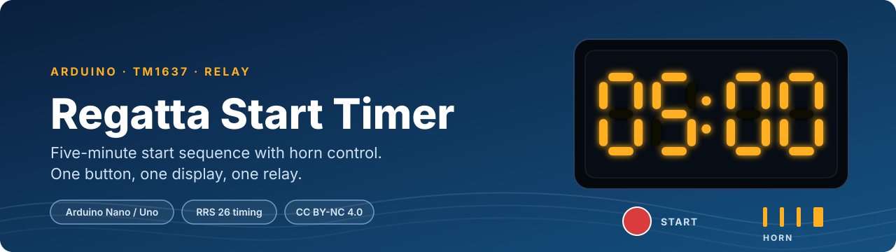
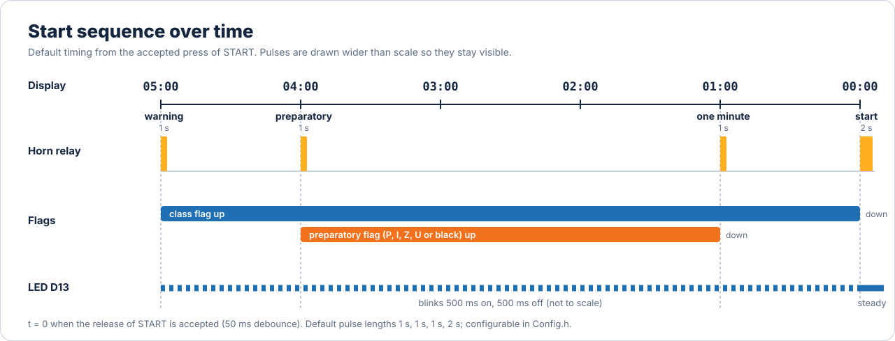
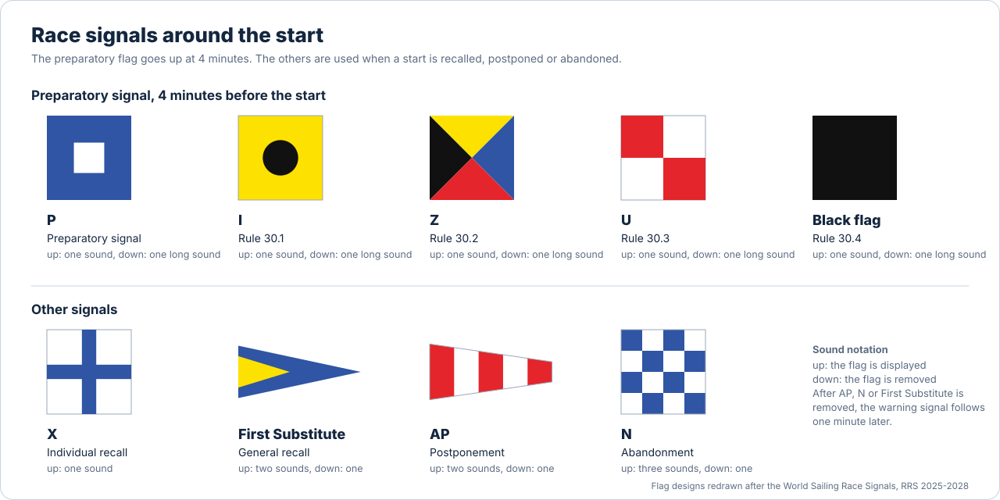
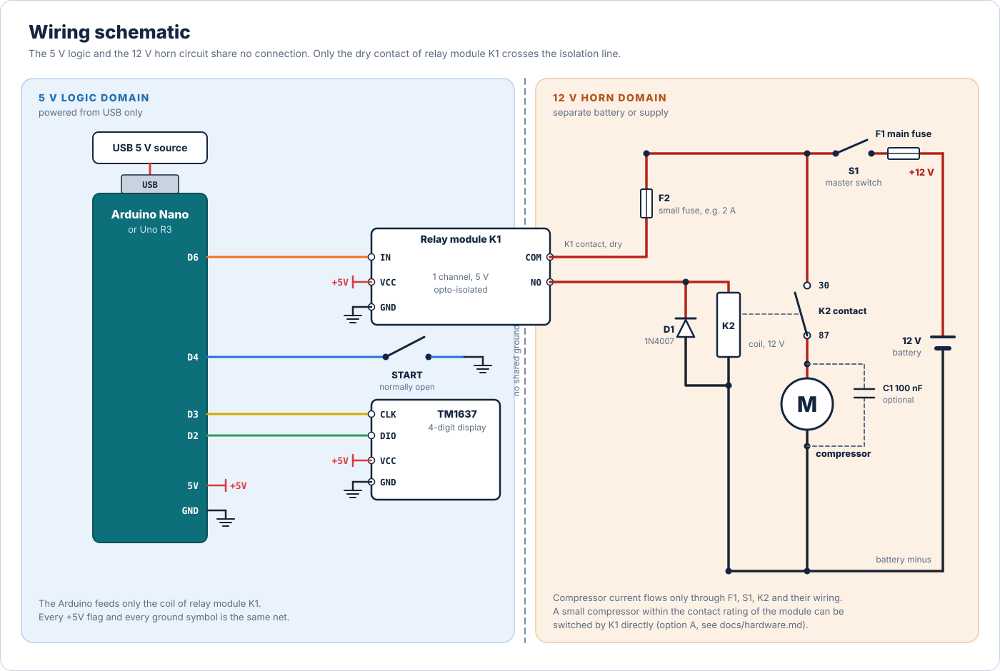
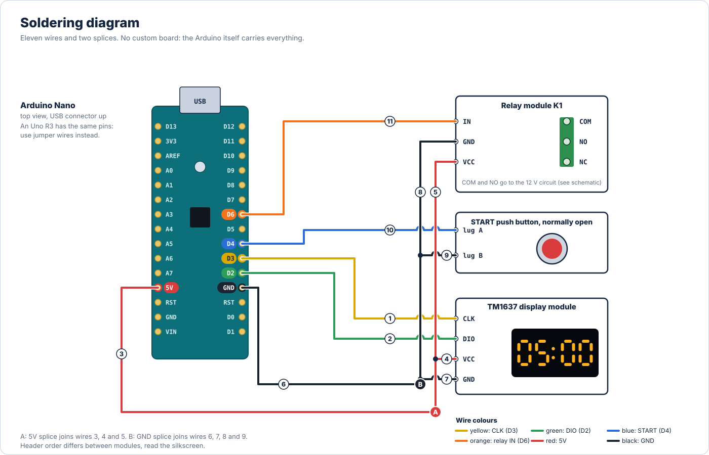

<p align="center">
  
</p>

<p align="center">
  <a href="LICENSE"></a>
  
  
  <a href="https://github.com/diggahpl/Regatta-start-timer/actions/workflows/ci.yml"></a>
  <a href="README.md"></a>
</p>

<h3 align="center">Czasomierz startowy dla komisji regatowej: jeden przycisk, jeden wyświetlacz, jeden przekaźnik.</h3>

<p align="center">
  <a href="#sekwencja-startowa">Sekwencja</a> ·
  <a href="#procedura-startowa-w-regatach">Procedura startowa</a> ·
  <a href="docs/hardware.md">Sprzęt</a> ·
  <a href="docs/firmware.md">Oprogramowanie</a> ·
  <a href="#budowa-i-wgranie-programu">Budowa</a> ·
  <a href="docs/testing.md">Testy</a>
</p>

Szczegółowa dokumentacja w katalogu `docs/` jest po angielsku. Ten plik zawiera pełny opis po polsku.

## O projekcie

Regatta Start Timer to czasomierz startowy dla komisji regatowej, zbudowany na Arduino. Jedno kliknięcie przycisku START uruchamia pięciominutową sekwencję. Wyświetlacz TM1637 pokazuje pozostały czas, a przy 05:00, 04:00, 01:00 i 00:00 urządzenie załącza przekaźnik. Przekaźnik uruchamia kompresor, który z osobnego zasilania wytwarza sygnał dźwiękowy. Przytrzymanie przycisku przez trzy sekundy przerywa cykl i przywraca stan gotowości.

Urządzenie jest przeznaczone dla komisji regatowych i trenerów, którzy chcą mieć powtarzalny sygnał ostrzeżenia, przygotowania, jednominutowy i startu, bez ręcznego odmierzania czasu.

Projekt własny, zaprojektowany i zbudowany przez [diggahpl](https://github.com/diggahpl). Pierwsza wersja powstała w 2025 roku i była używana na regatach. To repozytorium zawiera wersję uporządkowaną, opisaną i przetestowaną.

## W skrócie

| Jeden przycisk | Pięć minut | Cztery sygnały |
| :--- | :--- | :--- |
| Krótki klik uruchamia sekwencję, przytrzymanie przez 3 s ją przerywa. | Wyświetlacz pokazuje `05:00` w gotowości, odlicza do `00:00` i wraca do `05:00`. | Przekaźnik załącza kompresor przy 05:00, 04:00, 01:00 i 00:00. |

| Do ustawienia | Sprawdzone | Bez własnej płytki |
| :--- | :--- | :--- |
| Długość każdego sygnału, poziom wyzwalania przekaźnika i korekta zegara są w `Config.h`. | 110 scenariuszy testowych, wszystkie 13 celowych błędów wykryte. | Arduino Nano lub Uno i jedenaście odcinków lutowanego przewodu. |

## Sekwencja startowa

<p align="center">
  
</p>

Chwilą zerową jest moment, w którym urządzenie przyjęło zwolnienie przycisku START (po 50 ms eliminacji drgań styków). Pierwszy sygnał rozlega się wtedy od razu, a pozostałe są liczone od tej samej chwili.

| Wyświetlacz | Czas od startu | Sygnał (domyślnie) | Co robi komisja przy standardowej procedurze |
| :--- | ---: | ---: | :--- |
| `05:00` | 0 s | 1 s | Sygnał ostrzeżenia, flaga klasy w górę. |
| `04:00` | 60 s | 1 s | Sygnał przygotowania, flaga P, I, Z, Z z I, U albo czarna w górę. |
| `01:00` | 240 s | 1 s | Sygnał jednominutowy, flaga przygotowania w dół. |
| `00:00` | 300 s | 2 s | Sygnał startu, flaga klasy w dół. |

Domyślne długości 1 s, 1 s, 1 s i 2 s odtwarzają szkice z 2025 roku. Każdą z nich ustawia się w `Config.h` w zakresie od 1 do 5000 ms.

## Procedura startowa w regatach

Urządzenie odmierza czas i daje sygnały dźwiękowe. Flagi, falstarty i decyzje o odroczeniu albo przerwaniu wyścigu pozostają po stronie komisji regatowej. Ta sekcja zbiera przepisy, których dotyczy sekwencja, i pokazuje, jak z nią współpracować. Opis opiera się na wydaniu 2025-2028 Racing Rules of Sailing, czyli Przepisów Regatowych Żeglarstwa (PRŻ), według [oficjalnego PDF World Sailing](https://media.sailing.org/sailing/wp-content/uploads/2025/07/29083752/2025-2028-RRS-with-Changes-and-Corrections.pdf) w języku angielskim. Numeracja przepisów (26, 27, 29, 30, 32) jest taka sama jak w PRŻ. Domyślna długość sygnału jednominutowego (1 s) różni się od przepisu, który wymaga jednego długiego dźwięku, patrz koniec tej sekcji. Przepisy są tu opisane własnymi słowami, a nie zacytowane.

### Sekwencja według przepisu 26

Czas liczy się według sygnałów wizualnych, czyli flag. Brak sygnału dźwiękowego pomija się przy ustalaniu czasu.

| Minuty przed startem | Sygnał wizualny | Sygnał dźwiękowy | Nazwa |
| :---: | :--- | :--- | :--- |
| 5* | Flaga klasy w górę | jeden | Sygnał ostrzeżenia |
| 4 | Flaga P, I, Z, Z z I, U albo czarna w górę | jeden | Sygnał przygotowania |
| 1 | Flaga przygotowania w dół | jeden długi | Sygnał jednominutowy |
| 0 | Flaga klasy w dół | jeden | Sygnał startu |

\* Albo inaczej, jeśli zawiadomienie o regatach lub instrukcja żeglugi ustala inny czas. Sygnał ostrzeżenia dla następnej klasy ma paść razem z sygnałem startu poprzedniej klasy albo po nim.

### Flagi przygotowania

<p align="center">
  
</p>

Flaga przygotowania idzie w górę z jednym dźwiękiem, a schodzi minutę przed startem z jednym długim dźwiękiem. Wybór flagi określa, jakie ograniczenia obowiązują w ostatniej minucie przed sygnałem startu.

| Flaga | Przepis | Co obowiązuje w ostatniej minucie | Skutek naruszenia |
| :--- | :---: | :--- | :--- |
| P | brak | Tylko sygnał przygotowania. | Brak kary startowej. |
| I | 30.1 | Łódź, której jakakolwiek część kadłuba znalazła się po stronie trasy linii startu albo jej przedłużeń, musi przed startem przepłynąć przez przedłużenie linii tak, aby cały kadłub był po stronie przed startem. | Łódź, która tego nie zrobi, jest odwoływana flagą X. |
| Z | 30.2 | Żadna część kadłuba nie może być w trójkącie utworzonym przez końce linii startu i pierwszy znak. | Zidentyfikowana łódź dostaje bez rozprawy 20% kary punktowej, także gdy wyścig będzie startowany ponownie lub rozegrany od nowa. Przy ponownym przekroczeniu w kolejnej próbie startu dochodzi kolejne 20%. Kary nie ma, gdy wyścig odroczono lub przerwano przed sygnałem startu. |
| U | 30.3 | Ten sam trójkąt. | Zidentyfikowana łódź jest dyskwalifikowana bez rozprawy, ale nie wtedy, gdy wyścig będzie startowany ponownie lub rozegrany od nowa. |
| Czarna | 30.4 | Ten sam trójkąt. | Zidentyfikowana łódź jest dyskwalifikowana bez rozprawy, także gdy wyścig będzie startowany ponownie lub rozegrany od nowa, ale nie wtedy, gdy odroczono go albo przerwano przed sygnałem startu. Po falstarcie generalnym lub przerwaniu po starcie numer żagla jest wywieszany przed następnym sygnałem ostrzeżenia, a łódź nie może płynąć w powtórzonym wyścigu. |

Kombinacja Z z I oznacza, że obowiązują oba przepisy naraz.

### Falstarty, odroczenie i przerwanie wyścigu

| Sytuacja | Sygnał | Dźwięk | Co dalej |
| :--- | :--- | :--- | :--- |
| Falstart indywidualny, odwołanie indywidualne (przepis 29.1) | Flaga X | jeden w górę | Flaga wisi, aż wskazane łodzie wrócą na stronę przed startem, ale nie dłużej niż 4 minuty po starcie albo do minuty przed kolejnym startem, zależnie od tego, co nastąpi wcześniej. |
| Falstart generalny, odwołanie ogólne (29.2) | Pierwszy Zastępczy (First Substitute) | dwa w górę, jeden po opuszczeniu | Nowy sygnał ostrzeżenia pada minutę po opuszczeniu flagi. |
| Odroczenie (27.3) | AP | dwa w górę, jeden po opuszczeniu | Sygnał ostrzeżenia pada minutę po opuszczeniu AP, chyba że wyścig odroczono lub przerwano ponownie. |
| Odroczenie z drugą flagą | AP nad H, AP nad A | dwa w górę | Nad H: dalsze sygnały na lądzie. Nad A: dziś już bez wyścigów. |
| Przerwanie wyścigu (27.3 przed startem, 32.1 po starcie) | N | trzy w górę, jeden po opuszczeniu | Sygnał ostrzeżenia pada minutę po opuszczeniu N, chyba że wyścig przerwano ponownie lub odroczono. |
| Przerwanie z drugą flagą | N nad H, N nad A | trzy w górę | Nad H: dalsze sygnały na lądzie. Nad A: dziś już bez wyścigów. |

Flaga Y z jednym dźwiękiem oznacza obowiązek noszenia kamizelek asekuracyjnych (przepis 27.1).

### Jak użyć urządzenia przy odroczeniu i falstarcie generalnym

Jeśli sekwencja jeszcze trwa, przytrzymaj START przez 3 s: urządzenie wróci do `05:00` i zwolni przekaźnik. Po falstarcie generalnym sekwencja zwykle już się skończyła, więc przytrzymanie nie jest potrzebne. Gdy flaga AP, N albo Pierwszy Zastępczy zostanie opuszczona, puść przycisk START dokładnie minutę później. Pierwszy impuls nowej sekwencji jest sygnałem ostrzeżenia i rozlega się po zaakceptowaniu zwolnienia, czyli około 50 ms po puszczeniu przycisku.

Przy kolejnych klasach pamiętaj, że kliknięcia w trakcie cyklu są ignorowane aż do końca sygnału startu, czyli 2 s po `00:00`. Naciśnij START zaraz po zakończeniu tego sygnału. Sygnał ostrzeżenia następnej klasy padnie najwcześniej 2 s po sygnale startu poprzedniej. Przepis to dopuszcza, bo wymaga, by ostrzeżenie padło razem z sygnałem startu poprzedniej klasy albo po nim.

### Przykład: klasa Optimist

Sekwencję startową wyznacza przepis 26 razem z zawiadomieniem o regatach i instrukcją żeglugi danej imprezy, więc w klasie Optimist mogą się one różnić między regatami. Dwa publiczne dokumenty pokazują, co taka instrukcja może dodać. To przykłady, a nie powszechna praktyka.

| Źródło | Co mówi o starcie |
| :--- | :--- |
| [Instrukcja żeglugi regat Optimist w California Yacht Club, 2024](https://resultsarchive.calyachtclub.com/files/2024/2024OptiWCCSI_Final.pdf) | Flagą klasy jest flaga klasy Optimist. Przed wyścigiem lub serią wyścigów pomarańczowe flagi linii startu idą w górę z jednym dźwiękiem, co najmniej cztery minuty przed sygnałem ostrzeżenia. Łódź, która nie wystartuje w ciągu pięciu minut po swoim sygnale startu, dostaje DNS. Ta sama instrukcja ma dodatek dla początkującej Zielonej Floty, która startuje według sekwencji trzyminutowej (dodatek U), więc pięciominutowy timer do niej nie pasuje. |
| [Komunikat o próbach flagi U w klasie Optimist, 2014](https://www.sailingscuttlebutt.com/2014/03/27/optimist-class-test-new-starting-system/) | Komitet regatowy International Optimist Dinghy Association ogłosił próby z flagą U. Celem był system, który ogranicza falstarty generalne bez długiej procedury startowej i bez kary tak surowej jak przy czarnej fladze. Według przepisu 30.3 kara za flagę U nie obowiązuje, gdy wyścig będzie startowany ponownie lub rozegrany od nowa. |

Przed regatami przeczytaj zawiadomienie o regatach i instrukcję żeglugi swojej imprezy. Flaga przygotowania i czas sygnału ostrzeżenia mogą się różnić od domyślnych.

### Co urządzenie robi, a czego nie

Urządzenie pokazuje odliczanie i daje cztery sygnały dźwiękowe. Nie podnosi flag i nie podejmuje decyzji o falstarcie, odroczeniu ani przerwaniu wyścigu. Nie wytwarza też sygnałów dźwiękowych falstartu indywidualnego (jeden dźwięk) i generalnego (dwa dźwięki), więc komisja potrzebuje do nich ręcznego sygnału dźwiękowego.

Przepis 26 wymaga na jednej minucie jednego długiego dźwięku, a domyślny impuls trwa 1 s. Żeby uzyskać długi dźwięk, ustaw `SOUND_AT_ONE_MS`, na przykład na `3000`, i sprawdź efekt z prawdziwym sygnalizatorem.

## Sprzęt

<p align="center">
  
</p>

Układ ma dwie odseparowane strefy. W strefie 5 V pracują zasilanie USB, Arduino, wyświetlacz TM1637, przycisk START i moduł przekaźnikowy K1. W strefie 12 V jest osobny akumulator albo zasilacz, bezpiecznik F1, wyłącznik S1, przekaźnik samochodowy K2 i kompresor. Strefy nie mają wspólnej masy. Przechodzi między nimi tylko styk bezpotencjałowy K1.

W zalecanym układzie styk K1 załącza wyłącznie cewkę przekaźnika samochodowego K2, a styk K2 załącza kompresor. Dioda 1N4007 (D1) na cewce K2 chroni styk K1. Styk K1 może załączać kompresor bezpośrednio tylko wtedy, gdy jego dopuszczalny prąd (stały, obciążenie indukcyjne, prąd rozruchu) pokrywa pobór kompresora. Typowe moduły mają styki klasy 10 A, podane dla obciążenia rezystancyjnego, więc większość kompresorów wymaga K2.

<p align="center">
  
</p>

Nie ma własnej płytki drukowanej. Całość to gotowe Arduino i jedenaście odcinków lutowanego przewodu z dwoma rozgałęzieniami (5 V i GND).

| Element | Uwagi |
| :--- | :--- |
| Arduino Nano (ATmega328P) albo Uno R3 | Logika 5 V, kabel USB do wgrania programu. |
| Moduł TM1637, 4 cyfry z dwukropkiem | Piny `VCC`, `GND`, `CLK`, `DIO`. Kolejność pinów zależy od modułu. |
| Przycisk chwilowy START | Styk normalnie otwarty. W obudowie na wodę przycisk uszczelniony. |
| Moduł przekaźnikowy 5 V, 1 kanał (K1) | Najlepiej z optoizolacją i wyborem poziomu wyzwalania. |
| Przekaźnik samochodowy 12 V, klasa 30-40 A, z gniazdem (K2) | Styk załącza kompresor. |
| Dioda 1N4007 (D1) | Równolegle do cewki K2, katodą do plusa 12 V. |
| Bezpiecznik F1 i wyłącznik S1 | F1 przy akumulatorze, dobrany do kompresora i przewodów. S1 w przewodzie plusa za F1. |
| Bezpiecznik F2 | Mały, na przykład 2 A, w zasilaniu cewki K2. |
| Przewody, złącza, obudowa | Przewody mocy dobrane do prądu i długości. |

Pełna lista części jest w [hardware/BOM.csv](hardware/BOM.csv), a opis montażu, kolejność lutowania i lista przewodów w [docs/hardware.md](docs/hardware.md).

Kompresor pobiera przy rozruchu wielokrotność prądu pracy. Prąd rozruchu, dopuszczalny cykl pracy i zalecany bezpiecznik znajdziesz w karcie katalogowej swojego kompresora. Jego dźwięk spóźnia się względem impulsu przekaźnika, więc słyszalny sygnał jest krótszy niż impuls. Długości ustaw na słuch.

## Budowa i wgranie programu

1. Zainstaluj Arduino IDE z pakietem płytek **Arduino AVR Boards** (wersja 1.8.8).
2. W Menedżerze bibliotek zainstaluj **TM1637** autorstwa Avishaya Orpaza, wersja 1.2.0.
3. Otwórz `firmware/RegattaStartTimer/RegattaStartTimer.ino`. Plik `Config.h` otworzy się w drugiej karcie.
4. Wybierz płytkę (**Arduino Uno** albo **Arduino Nano**) i port. Dla Nano wybierz procesor `ATmega328P` albo `ATmega328P (Old Bootloader)`, zgodnie z bootloaderem płytki.
5. Wgraj program przy otwartym S1 (strefa 12 V odłączona). Po wgraniu wyświetlacz pokazuje `05:00`.

To samo z wiersza poleceń, po instalacji `arduino-cli`:

```bash
arduino-cli core install arduino:avr@1.8.8
arduino-cli lib install "TM1637@1.2.0"
arduino-cli compile --fqbn arduino:avr:uno firmware/RegattaStartTimer
arduino-cli upload  --fqbn arduino:avr:uno -p <port> firmware/RegattaStartTimer
```

Dla Nano użyj `arduino:avr:nano:cpu=atmega328` albo `arduino:avr:nano:cpu=atmega328old`. Program zajmuje 2710 B pamięci programu (8%) i 90 B pamięci na zmienne globalne (4%), a kompilacja z `--warnings all` nie daje ostrzeżeń. Szczegóły, w tym warianty z flagami `-D`, są w [docs/firmware.md](docs/firmware.md).

Przed podłączeniem kompresora sprawdź na lampce albo na cewce K2, że przekaźnik pozostaje zwolniony po włączeniu zasilania, po resecie i podczas wgrywania programu. Wiele tanich modułów przekaźnikowych załącza się stanem niskim. Jeśli tak jest w Twoim module, ustaw `HORN_ACTIVE_HIGH` na `0`.

## Obsługa

| Działanie | Zachowanie |
| :--- | :--- |
| Włączenie zasilania lub reset | Wyświetlacz pokazuje `05:00`, przekaźnik jest zwolniony, dioda D13 świeci stale. Przycisk wciśnięty przy włączeniu nie uruchamia cyklu. |
| Krótki klik (poniżej 3 s) | Odliczanie rusza po zwolnieniu przycisku, a pierwszy sygnał rozlega się od razu. Każda zmiana stanu przycisku musi być stabilna przez 50 ms. |
| W trakcie odliczania | Dioda D13 miga co 500 ms. Kliknięcia są ignorowane. |
| Przytrzymanie przez 3 s | Cykl zostaje przerwany, przekaźnik zwolniony natychmiast, a wyświetlacz wraca do `05:00`. Po zwolnieniu odczekaj 1 s przed kolejnym naciśnięciem. |
| `00:00` | Sygnał startu trwa 2 s, dioda świeci stale, potem urządzenie wraca do `05:00` i czeka na kolejny klik. |

Naciśnięcie rozpoczęte mniej niż 1 s po poprzednim zwolnieniu jest pomijane, także gdy przycisk puścisz dopiero po upływie tej sekundy.

## Konfiguracja

Wszystkie ustawienia są w pliku `firmware/RegattaStartTimer/Config.h`. Opcje makrowe można też nadpisać flagą `-D`, na przykład `--build-property build.extra_flags=-DHORN_ACTIVE_HIGH=0`.

| Opcja | Domyślnie | Znaczenie |
| :--- | :---: | :--- |
| `HORN_ACTIVE_HIGH` | `1` | Poziom wyzwalania modułu przekaźnikowego: `1` załącza stanem wysokim, `0` stanem niskim. |
| `SOUND_AT_FIVE_MS` | `1000` | Długość sygnału przy 05:00. |
| `SOUND_AT_FOUR_MS` | `1000` | Długość sygnału przy 04:00. |
| `SOUND_AT_ONE_MS` | `1000` | Długość sygnału przy 01:00. |
| `SOUND_AT_START_MS` | `2000` | Długość sygnału startu przy 00:00. |
| `CLOCK_TRIM_PPM` | `0` | Korekta zegara w ppm, od -10000 do 10000. Dodatnia wartość oznacza, że urządzenie się spóźnia. |
| `DISPLAY_BRIGHTNESS` | `5` | Jasność wyświetlacza, od 0 do 7. |
| `SHOW_COLON` | `1` | `1` pokazuje stały dwukropek `MM:SS`, `0` wyświetla `MMSS` bez separatora. |

Każdy sygnał musi trwać od 1 do 5000 ms, co sprawdza kompilator. Cały wyświetlacz jest odświeżany co sekundę, bo przekaźnik i silnik kompresora potrafią zakłócić rejestry TM1637.

Korektę zegara wyznaczysz tak: zmierz czas od pierwszego do ostatniego impulsu na wyjściu D6 względem zegara odniesienia i wylicz `CLOCK_TRIM_PPM = (zmierzone_s - 300) / 300 * 1 000 000`.

## Jakość i testy

Szkic sprawdzają testy natywne, które uruchamiają go bez płytki, na atrapach `millis()`, pinów i biblioteki TM1637, z symulacją czasu co 1 ms.

| Dowód | Wynik |
| :--- | :--- |
| Scenariusze testowe w 6 wariantach budowy | 110 scenariuszy, wszystkie przechodzą. |
| Test mutacyjny: 13 celowo zepsutych wersji szkicu | Wszystkie 13 wykryte. |
| Porównanie ze szkicem z 2025 roku | W 18 scenariuszach ślady pinów i ekranu są identyczne. Oryginał spełnia wszystkie asercje poza nową funkcją odświeżania wyświetlacza, więc logika z 2025 roku była poprawna. |
| Kompilacja dla Uno i obu wariantów Nano | Bez ostrzeżeń, 2710 B pamięci programu i 90 B RAM. |

```bash
make -C test test
```

Testy działają na komputerze z 32-bitowym `int`, a Arduino ma 16-bitowy, i używają atrap, więc nie zastępują prób na urządzeniu. Wersja z 2025 roku była używana na regatach, ale to repozytorium nie zawiera jeszcze zapisanych pomiarów tej wersji programu na prawdziwym urządzeniu: czasu względem zegara odniesienia, prądu rozruchu kompresora i pracy pod pełnym obciążeniem. Opis testów jest w [docs/testing.md](docs/testing.md), a uwagi z przeglądu projektu w [docs/design-review.md](docs/design-review.md).

## Bezpieczeństwo i ograniczenia

Urządzenie pomaga odmierzać czas i nie zastępuje niezależnego stopera, flag ani ręcznego sygnału dźwiękowego. Za przebieg procedury startowej odpowiada komisja regatowa.

Dokładność zegara zależy od płytki. Uno R3 ma rezonator ceramiczny (około ±0,5%, czyli do 1,5 s na 300 s). Nano z kwarcem jest znacznie dokładniejsze, ale klony bywają różne. Zmierz czas i w razie potrzeby ustaw `CLOCK_TRIM_PPM`.

Przy kompresorze zamontuj bezpiecznik F1 blisko akumulatora, trzymaj wyłącznik S1 w zasięgu ręki i dobierz przewody do prądu i długości. Pierwsze próby rób na lampce albo na cewce K2, a przy próbach sygnału z bliska używaj ochrony słuchu.

Watchdog sprzętowy jest celowo wyłączony. Stary bootloader Nano może po resecie od watchdoga nie wystartować. Zabezpieczeniem jest wyłącznik S1 i bezpiecznik F1 w strefie 12 V.

## Struktura repozytorium

```text
Regatta-start-timer/
├── firmware/RegattaStartTimer/   szkic (RegattaStartTimer.ino) i ustawienia (Config.h)
├── hardware/                     schemat, rysunek okablowania, lista części (BOM.csv)
├── docs/                         dokumentacja (po angielsku) i rysunki w docs/images/
├── test/                         testy natywne, test mutacyjny, porównanie z wersją z 2025
├── archive/2025-original/        pierwotny szkic z 2025 roku
├── tools/generate_diagrams.py    generator rysunków SVG
├── LICENSE, NOTICE.md            licencja CC BY-NC 4.0 i informacja o autorstwie
├── README.md                     wersja angielska
└── README.pl.md                  ten plik
```

## Licencja i autorstwo

Projekt własny [diggahpl](https://github.com/diggahpl), udostępniony na licencji [Creative Commons Uznanie autorstwa-Użycie niekomercyjne 4.0 (CC BY-NC 4.0)](https://creativecommons.org/licenses/by-nc/4.0/). Pełny tekst jest w pliku [LICENSE](LICENSE), a informacja o autorstwie w [NOTICE.md](NOTICE.md).

Licencja wymaga podania autora i zabrania użycia komercyjnego. Przy korzystaniu z projektu użyj takiej informacji:

```text
Regatta Start Timer by diggahpl, https://github.com/diggahpl/Regatta-start-timer, CC BY-NC 4.0
```

W sprawach wykraczających poza licencję napisz przez zgłoszenie w repozytorium na GitHubie.

Przepisy Regatowe Żeglarstwa i wzory flag sygnałowych należą do World Sailing. W tym repozytorium są tylko odwołania do nich i własne rysunki, odtworzone według tabeli sygnałów regatowych z wydania 2025-2028.
