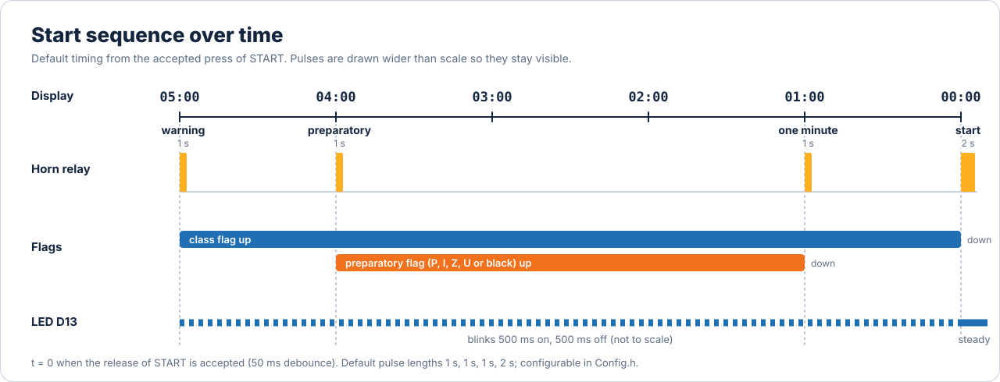
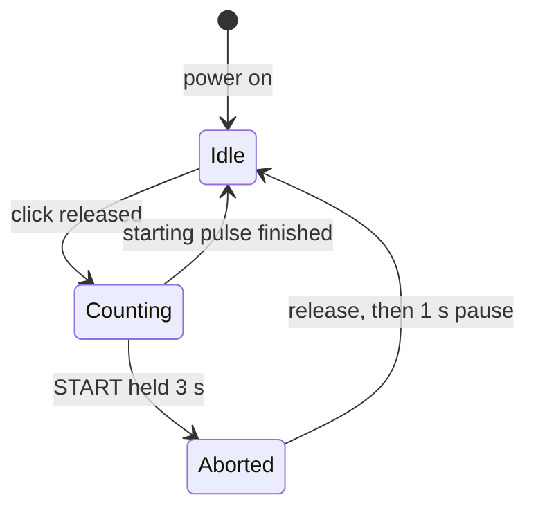

# Firmware

The firmware is one Arduino sketch plus one settings file. It needs the TM1637 library by Avishay Orpaz, version 1.2.0, and no other library.

| File | Purpose |
| --- | --- |
| `firmware/RegattaStartTimer/RegattaStartTimer.ino` | button handling, countdown, relay and display |
| `firmware/RegattaStartTimer/Config.h` | pins, signal lengths, relay trigger level, clock trim, display options |

The sketch folder must keep the name `RegattaStartTimer`, because the Arduino IDE requires the folder to match the `.ino` file.

## Pins

| Pin | Connected to |
| --- | --- |
| D2 | TM1637 DIO |
| D3 | TM1637 CLK |
| D4 | START button, normally open, other contact to GND (internal pull-up) |
| D6 | relay module input |
| D13 | built-in LED |

## How a cycle works



A short click on START is accepted when the release has been stable for 50 ms. That instant is t = 0. The relay output pulls in at once for the warning signal, and the display starts counting down from 05:00.

| Display | Time from t = 0 | Relay pulse (default) |
| --- | ---: | ---: |
| `05:00` | 0 s | 1 s |
| `04:00` | 60 s | 1 s |
| `01:00` | 240 s | 1 s |
| `00:00` | 300 s | 2 s |

The LED on D13 is steady while idle, blinks 500 ms on and 500 ms off while counting, and is steady again from `00:00`. The display shows `00:00` during the 2 s starting pulse, and then the device returns to `05:00` and waits for the next click.



Button handling:

| Event | While idle | While counting |
| --- | --- | --- |
| Click, released within 3 s | starts a cycle at the accepted release | ignored |
| START held for 3 s | stays on `05:00` | aborts, relay released at once |
| Press less than 1 s after the previous release | ignored, even if released later | ignored |
| Button held at power-up | ignored, and releasing it starts nothing | not applicable |
| Contact bounce or a pulse shorter than 50 ms | ignored | ignored |
| Press that began during a cycle, still held when it ends | releasing it starts nothing | not applicable |

## Timing details

The display shows the remaining time rounded up to a whole second. It reads `05:00` for the first second and `00:01` for the last, and `00:00` appears together with the starting pulse.

Every relay window is computed from the same start instant, so the four pulses cannot drift against each other. A window that has already closed is skipped and never played late: if the main loop stalls for 2 s across the 04:00 window, the pulse is lost and the display catches up. All time differences use unsigned arithmetic, so the `millis()` rollover after about 49 days does not matter.

The relay is released before its pin becomes an output, so the module never gets a pulse at start-up. At power-up the sketch also reads the button, and a button that is already pressed cannot start a cycle.

## Settings in Config.h

Options written as `#ifndef` blocks can also be set at build time with `-D` flags, for example `-DHORN_ACTIVE_HIGH=0`.

| Option | Default | Range | Meaning |
| --- | ---: | --- | --- |
| `HORN_ACTIVE_HIGH` | 1 | 0 or 1 | trigger level of the relay module input. Many cheap modules pull in on LOW, set 0 for them |
| `SOUND_AT_FIVE_MS` | 1000 | 1 to 5000 | relay pulse at 05:00, warning signal |
| `SOUND_AT_FOUR_MS` | 1000 | 1 to 5000 | relay pulse at 04:00, preparatory signal |
| `SOUND_AT_ONE_MS` | 1000 | 1 to 5000 | relay pulse at 01:00. Rule 26 describes one long sound here, for example set 3000 |
| `SOUND_AT_START_MS` | 2000 | 1 to 5000 | relay pulse at 00:00, starting signal |
| `CLOCK_TRIM_PPM` | 0 | -10000 to 10000 | clock correction, see below. Positive when the timer is late |
| `DISPLAY_BRIGHTNESS` | 5 | 0 to 7 | display brightness |
| `SHOW_COLON` | 1 | 0 or 1 | 1 shows `MM:SS`, 0 shows `MMSS` as the 2025 sketch did |

The signal lengths and the trim are checked at compile time, so a wrong value stops the build. These constants are fixed in `Config.h` and are not meant to be overridden: `DISPLAY_REFRESH_MS` (1000), `MAX_HORN_MS` (5000), `DEBOUNCE_MS` (50), `RESET_HOLD_MS` (3000), `PRESS_GAP_MS` (1000) and the pin numbers. Some test scenarios assume them.

## Build and upload

With the Arduino IDE:

1. Install the board package Arduino AVR Boards and the library TM1637 by Avishay Orpaz, version 1.2.0 (Library Manager).
2. Open `firmware/RegattaStartTimer/RegattaStartTimer.ino`.
3. Choose Arduino Uno or Arduino Nano and the port. For a Nano with the ATmega328P pick the processor that matches the bootloader. If an upload with `ATmega328P` fails, try `ATmega328P (Old Bootloader)`.
4. Verify, then Upload, with S1 open. The display shows `05:00`.

With the Arduino CLI, from the repository root:

```sh
arduino-cli core update-index
arduino-cli core install arduino:avr@1.8.8
arduino-cli lib install "TM1637@1.2.0"
arduino-cli compile --fqbn arduino:avr:uno firmware/RegattaStartTimer
arduino-cli compile --fqbn arduino:avr:nano:cpu=atmega328 firmware/RegattaStartTimer
arduino-cli compile --fqbn arduino:avr:nano:cpu=atmega328old firmware/RegattaStartTimer
arduino-cli upload -p <port> --fqbn arduino:avr:nano:cpu=atmega328 firmware/RegattaStartTimer
```

Build variants without editing the file:

```sh
arduino-cli compile --fqbn arduino:avr:uno \
  --build-property "build.extra_flags=-DHORN_ACTIVE_HIGH=0" firmware/RegattaStartTimer
arduino-cli compile --fqbn arduino:avr:uno \
  --build-property "build.extra_flags=-DCLOCK_TRIM_PPM=1000 -DSOUND_AT_ONE_MS=3000" firmware/RegattaStartTimer
```

Measured with Arduino CLI 1.5.1, Arduino AVR Boards 1.8.8 and TM1637 1.2.0, compiling with `--warnings all`:

| Build | Flash | RAM | Warnings |
| --- | ---: | ---: | --- |
| Uno R3, Nano (new and old bootloader), default settings | 2710 B (8 %) | 90 B (4 %) | none |
| Uno R3 with trim and a 3 s one-minute signal | 3140 B (9 %) | 90 B (4 %) | none |
| 2025 original | 2694 B | 86 B | not recorded |

## Clock accuracy and trim

`millis()` follows the board clock. The Uno R3 uses a ceramic resonator with a tolerance of about 0.5 %, which is up to 1.5 s over 300 s. A Nano with a quartz crystal is far better, but clones vary, so measure your board.

1. Record the relay output (or the relay indicator LED together with a reference clock) over a full cycle, for example with a logic analyser on D6, or a video that shows the display and a reference clock.
2. Measure the time from the start of the first pulse to the start of the last pulse. It should be 300 s.
3. Compute `CLOCK_TRIM_PPM = (measured seconds - 300) / 300 * 1000000`. A timer that runs late gives a positive value.
4. Put the value into `Config.h`, upload and measure again.

Worked example: the measured interval is 300.45 s, so the timer is 0.45 s late. The trim is 0.45 / 300 * 1000000 = 1500 ppm. With `CLOCK_TRIM_PPM 1500` the sketch scales elapsed time by 1.0015, and the last pulse comes 0.45 s earlier, at 300.00 s. The trim only compensates a constant error. Temperature changes the clock a little, so repeat the measurement in the conditions where you use the device.

## Changes since the 2025 sketch

| Change | Reason |
| --- | --- |
| Output renamed to `PIN_HORN_RELAY` with `HORN_ACTIVE_HIGH` | relay modules differ in trigger level |
| `Config.h` split from the sketch | builders edit one short file, and CI builds variants with `-D` flags |
| Periodic display refresh every 1 s | relay and motor noise can corrupt the TM1637 registers, and an idle display would stay wrong |
| Optional `CLOCK_TRIM_PPM` | the Uno resonator can be 1.5 s off over five minutes |
| English comments | the repository language |

The button and timing logic is unchanged. `make -C test equivalence` proves it: both sketches give identical pin and display traces in every default scenario.

The AVR watchdog is not enabled. A watchdog reset would release the relay, but the old Nano bootloader can fail to leave a watchdog reset and then locks up, which is worse than the problem it solves. The protection against a stuck relay or a hung microcontroller is S1 and F1 in the 12 V domain, see [`hardware.md`](hardware.md).
