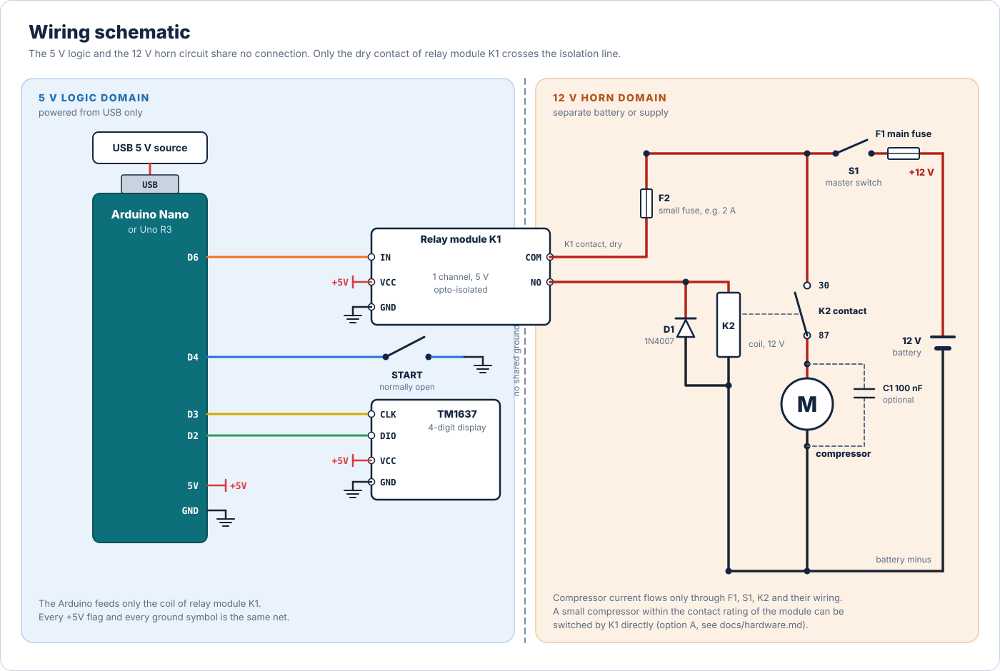
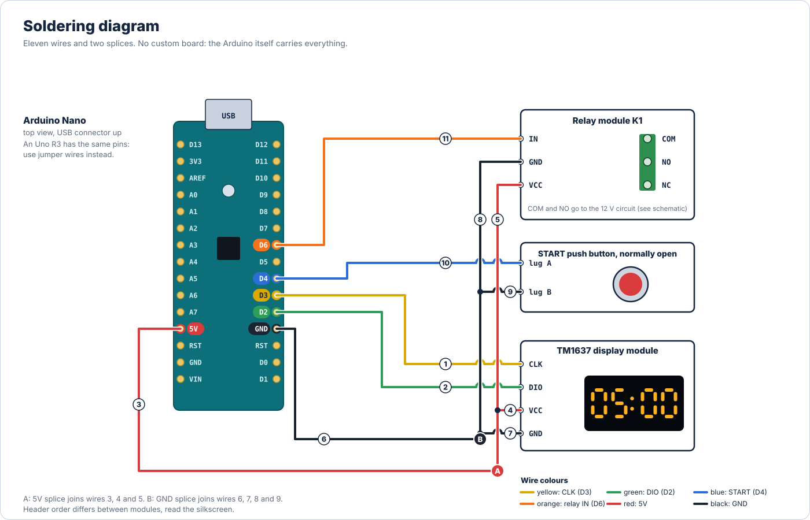

# Hardware

The build is point to point: an Arduino Nano (or Uno), a TM1637 display, one push button and a relay module, joined by 11 short wires and two splices. There is no custom circuit board. The compressor has its own supply and is switched by a relay, so no compressor current flows through the Arduino.

## Two separate domains

| Domain | Contents | Supply |
| --- | --- | --- |
| 5 V logic | Arduino, TM1637, START button, coil side of relay module K1 | USB power bank or 5 V charger |
| 12 V horn | F1, S1, F2, K2 with D1, compressor | separate battery or supply |

The two minus rails are not connected. Only the dry contact of K1 (COM and NO) passes between the domains, and that contact is isolated from the coil side of the module. Compressor start current and motor noise stay on the 12 V side, and a fault there cannot reach the USB source.

## Relay stage: two options

| Option | What K1 switches | Choose it when |
| --- | --- | --- |
| A, direct | the compressor itself | the contact rating of K1 for DC, an inductive load and the starting current clearly covers the compressor. Module contacts are often marked 10 A for resistive loads, and a motor starts with a multiple of its running current, so this works for small compressors only |
| B, recommended | the coil of K2, a 12 V automotive relay, and K2 switches the compressor | the compressor current is unknown, more than a few amperes, or you want margin. Needs D1 and F2 |

Option B wiring in the 12 V domain, using the standard labels of a 4-pin automotive relay (85 and 86 coil, 30 common, 87 normally open):

1. Battery plus goes through F1 and S1 to a junction.
2. From the junction, one branch goes to K2 terminal 30. K2 terminal 87 goes to the compressor plus.
3. The other branch goes through F2 to K1 COM. K1 NO goes to K2 terminal 86. K2 terminal 85 goes to battery minus.
4. D1 sits across the K2 coil: cathode (the band) on 86, anode on 85. It takes the inductive kick of the coil, so the contact of K1 does not.
5. The compressor minus goes to battery minus. An optional 100 nF ceramic capacitor (C1) across the motor terminals, with short leads, reduces brush noise.

Check the pinout printed on your relay. If it has a diode or resistor built in across the coil, the coil polarity matters and D1 is not needed.

## Parts

| Ref | Qty | Part | Notes |
| --- | ---: | --- | --- |
| U1 | 1 | Arduino Nano (classic) or Uno R3 | ATmega328P, 5 V logic. A Nano with a quartz crystal keeps time better than an Uno with a ceramic resonator |
| U2 | 1 | TM1637 4-digit 7-segment module | 5 V, colon between the middle digits, header CLK DIO VCC GND |
| SW1 | 1 | Push button START | momentary, normally open, sealed for outdoor use |
| K1 | 1 | Relay module, 5 V, 1 channel | dry contact COM NO NC, opto-isolated with selectable trigger level preferred |
| K2 | 1 | Automotive relay with socket | 12 V coil, 30 to 40 A class contacts, option B |
| D1 | 1 | Diode 1N4007 | across the K2 coil, option B |
| F1 | 1 | Fuse with holder | close to the battery plus, value from the compressor data sheet and the wire rating |
| F2 | 1 | Small fuse with holder | for example 2 A, K2 coil feed, option B |
| S1 | 1 | Master switch | DC rated for the compressor current |
| C1 | 1 | Ceramic capacitor 100 nF | optional, across the motor terminals |
| PS1 | 1 | USB 5 V power bank or charger | 1 A or more |
| PS2 | 1 | 12 V battery or supply | for the horn domain |
| W1 | 1 set | Signal wire | 0.25 to 0.5 mm2, stranded, six colours |
| W2 | 1 set | Power wire | cross-section for the compressor current and run length |
| X1 | 1 set | Heat-shrink, cable ties, glands, enclosure | strain relief on every cable |

The same list is in [`hardware/BOM.csv`](../hardware/BOM.csv) for ordering. The compressor and horn are assumed to exist already.

## Wiring

The Nano has two headers of 15 pins. With the USB connector at the top, counting rows from the USB end:

| Header | Rows used |
| --- | --- |
| Right | D6 (row 7), D4 (row 9), D3 (row 10), D2 (row 11), GND (row 12) |
| Left | 5V (row 12) |

Eleven wire segments, two splices:

| No | From | To | Colour |
| ---: | --- | --- | --- |
| 1 | D3 | TM1637 CLK | yellow |
| 2 | D2 | TM1637 DIO | green |
| 3 | 5V (left header) | 5V splice | red |
| 4 | 5V splice | TM1637 VCC | red |
| 5 | 5V splice | relay module VCC | red |
| 6 | GND (right header) | GND splice | black |
| 7 | GND splice | TM1637 GND | black |
| 8 | GND splice | relay module GND | black |
| 9 | GND splice | START button lug B | black |
| 10 | D4 | START button lug A | blue |
| 11 | D6 | relay module IN | orange |

The 5V splice joins three wire ends: the wire from the 5V pad and the two wires to VCC. The GND splice joins four: the wire from the GND pad and the wires to the display, the relay module and the button. The 5V pad is on the left header, so wire 3 leaves from the left side and runs under the board.

The pin order of TM1637 modules and relay modules differs between products. Read the silkscreen on your parts and follow the labels, not the position in the picture. The two button lugs are interchangeable.

## Soldering guide

1. Gather a soldering iron with temperature control, flux, thin solder, heat-shrink tubing in three sizes, a wire stripper, a multimeter and a helping hand.
2. Cut the wires to length for your enclosure. About 10 to 20 cm is enough for a compact box. Cut one length per wire in the table, in its colour.
3. Slide a piece of heat-shrink over each wire before soldering it. It cannot be added afterwards.
4. Strip 3 to 4 mm, twist the strands and tin them.
5. Solder the wires to the Nano. If the Nano has no header pins, solder the wires into the through holes from the top and trim the leads on the underside. If it has headers, solder to the underside of the pins or use plug-in connectors.
6. Make the two splices. Twist the tinned ends together, solder, let the joint cool, then slide the heat-shrink over it and shrink it.
7. Solder the other wire ends to the TM1637 header, the relay module header and the two button lugs. Cover each lug with heat-shrink.
8. Look at every joint under good light. A joint should be shiny, with solder flowing onto both parts. Reflow any dull or ball-shaped joint.
9. With nothing connected to power, measure with the multimeter. Each wire must show continuity end to end, and 5V and GND must not show a short.
10. Fix the wires with cable ties or a dab of hot glue next to each joint, so a pull on the cable does not reach the solder.

## First power-up checklist

Do these in order and stop at the first surprise. Keep the 12 V domain disconnected until step 6.

| Step | Action | Expected result |
| ---: | --- | --- |
| 1 | Measure between 5V and GND with the multimeter | no short |
| 2 | Connect USB only | display shows `05:00` with a steady colon, D13 is on, the relay module is not energised |
| 3 | Press the reset button, then replug USB | the relay stays released during reset and start-up |
| 4 | Upload the sketch with the relay module connected | the relay stays released while the upload runs |
| 5 | If the relay is pulled in at idle | set `HORN_ACTIVE_HIGH` in `Config.h` to the other value (0 for low-level trigger modules), upload again and repeat steps 2 to 4 |
| 6 | Connect the 12 V domain with F1, S1, F2 and the K2 coil only, no compressor | nothing happens yet, K2 stays released |
| 7 | Short click on START | the countdown starts and D13 blinks. K2 clicks at 05:00, 04:00, 01:00 and 00:00, cleanly and without chatter |
| 8 | Optionally put a 12 V lamp on the K2 contact | the lamp follows the pulses |
| 9 | Connect the compressor, aim the horn away from people and wear hearing protection | the compressor starts and stops with each pulse, S1 cuts it |
| 10 | Hold START for 3 s during a pulse | the relay releases at once and the display returns to `05:00` |

## Power notes

Power the Nano through its USB connector from a power bank or a 5 V charger. Do not feed the horn battery into VIN if you want to keep the domains separate.

If you prefer one battery for everything, a DC-DC converter with a USB output works, but it joins the two minus rails and gives up the electrical separation. The dry contact of K1 still isolates the coil side, and the display refresh in the firmware helps against noise, but expect more disturbance on the 5 V side.

Some power banks switch themselves off when the load is very small. The Nano and display draw little at idle, so test the bank over a longer idle time before relying on it, or pick one with a low-current mode.

## Compressor cautions

| Topic | What to do |
| --- | --- |
| Starting current | A motor draws a multiple of its running current at start. Read the starting current in the data sheet and size K2, F1 and the wiring for it |
| Fuse and wire | F1 protects the wire, so the wire must carry more than F1 allows. Size the cross-section from the compressor current and the length of the run, using the wire manufacturer's ampacity table |
| Spin-up lag | The sound follows the relay pulse after a moment, so the audible signal is shorter than the pulse. Tune `SOUND_AT_*_MS` by ear with the real horn. A pulse is limited to 5 s by `MAX_HORN_MS` |
| Duty cycle | Check the allowed on time and cool-down in the data sheet. A long signal at 01:00 loads the compressor more than the 1 s default |
| Motor noise | Keep the 12 V wiring away from the signal wires, add C1 across the motor and keep the wires of the display short |
| Master switch | Fit S1 where the operator can reach it. It is the real safety, because a welded relay contact or a hung microcontroller cannot be fixed in software |

## Enclosure and marine notes

Put the display behind a window that stays readable in direct sun, and use a sealed button. Run every cable through a gland with strain relief. Keep K2, the fuses and S1 in the 12 V compartment close to the battery, and run only thin wires between the compartments. In salt air consider a protective coating on the Arduino and the modules. Label S1 and the fuses.

## What you have to fill in

This repository does not know your compressor. Before the first full test, write down these values from the data sheets and check them against the parts you bought:

| Value | Where it matters |
| --- | --- |
| Running current and starting current of the compressor | K2 rating, F1 value, wire cross-section |
| Allowed duty cycle | length of the signals |
| Contact rating of K1 (DC, inductive load) | option A only |
| Coil current of K2 | F2 value, check that K1 carries it easily |
| Trigger level of K1 | `HORN_ACTIVE_HIGH` |
